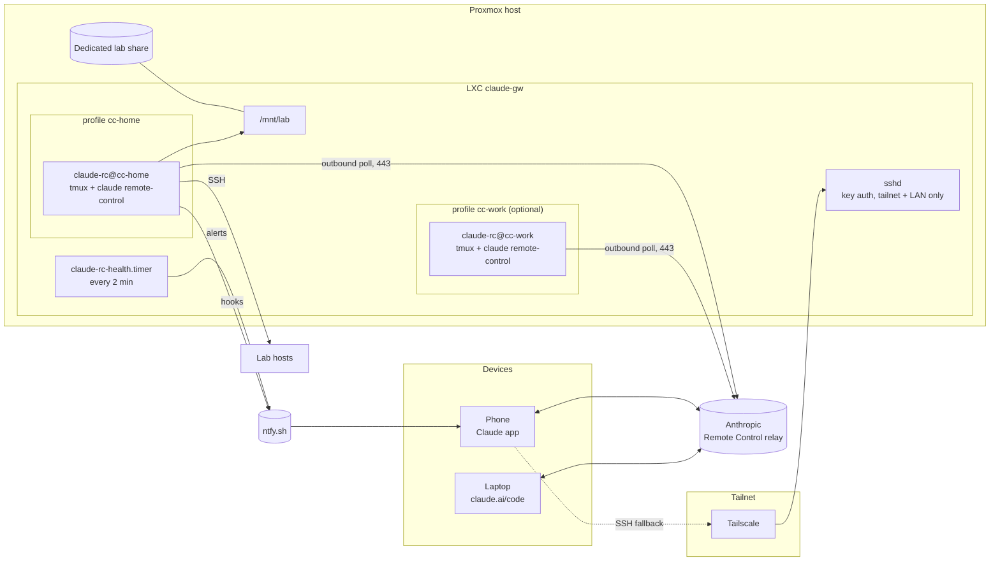
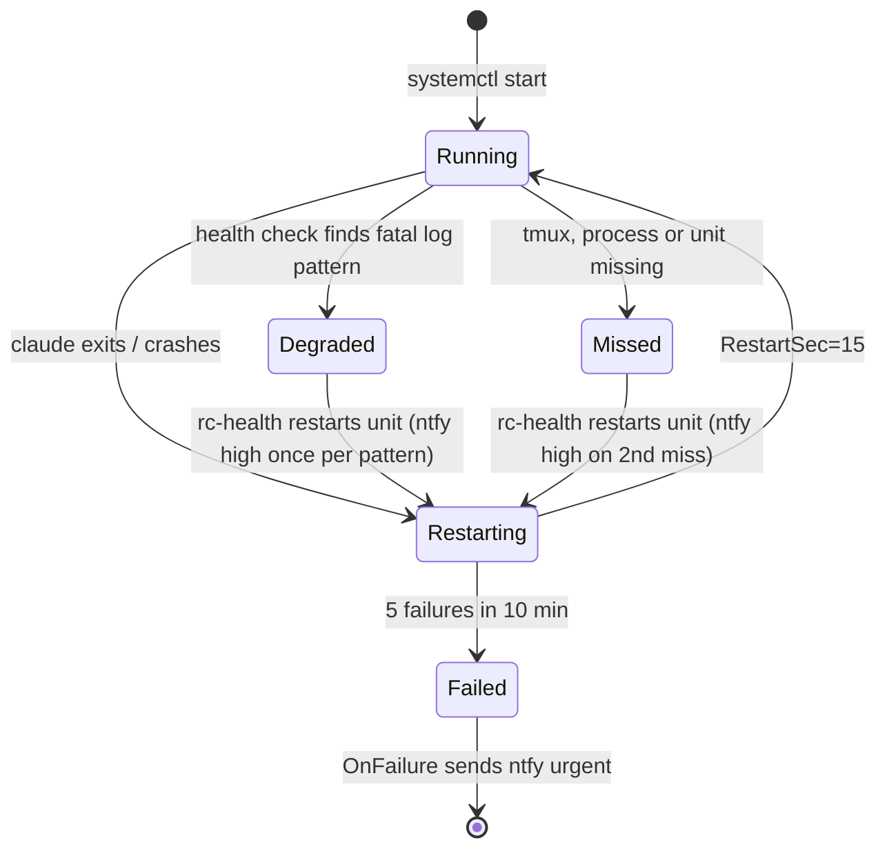
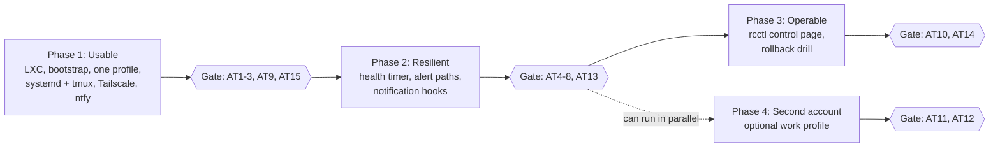

# claude-gw design

## Summary

A single always-on LXC container on a Proxmox host (`claude-gw`) runs Claude Code in Remote Control **server mode**, one server per account profile, supervised by systemd and tmux. New sessions can be started from the Claude mobile app, a laptop, or claude.ai/code anywhere in the world without first shelling in. Tailscale provides the fallback SSH path (and, in phase 3, the only route to a small Go control page). Failures that supervision cannot recover from are pushed to the phone via ntfy.

Why this shape: Remote Control is the only first-party mechanism that keeps execution and filesystem access on the lab side while exposing a full session to mobile and web. A machine running `claude remote-control` appears as a device in the Code tab of the Claude app, and a session can be started from there on demand.

Goals, in priority order:

1. Start or resume a Claude Code session against lab resources from any device, from anywhere, in under 30 seconds and with no SSH step.
2. Sessions survive the container rebooting, the `claude` process crashing, or a network blip, without manual intervention.
3. When they do not survive, the phone is told within two minutes.
4. Separate accounts (for example personal and work) never share credentials, transcripts or working trees.
5. Every change to the gateway itself is versioned and reversible.

## Requirements and constraints

| # | Requirement | How it is met |
| --- | --- | --- |
| R1 | Start a new session from mobile or a laptop without shelling in first | `claude remote-control` server mode |
| R2 | Sessions reach the lab filesystem and lab hosts | One dedicated share bind-mounted at `/mnt/lab`, SSH keys per profile, local MCP servers |
| R3 | Tailscale and SSH access to the gateway as a fallback | Also needed for commands Remote Control cannot run from mobile (`/plugin`, `/resume`, `claude mcp login`) |
| R4 | Crashed processes restart; the service survives reboots | systemd template unit per profile, tmux as the pty holder |
| R5 | Alert via ntfy when a restart fails or a server stays down | systemd `OnFailure=` plus a health timer |
| R6 | A control page for session management and inspection | Phase 3: small Go service, tailnet-only |
| R7 | Separate identities per account | `CLAUDE_CONFIG_DIR` per profile, separate Linux users, separate units |
| R8 | Full change control and rollback for the gateway itself | Git tags, `make deploy`, vzdump backups |

| # | Constraint | Consequence |
| --- | --- | --- |
| C1 | Remote Control requires a claude.ai subscription login; API keys and `setup-token` long-lived tokens are refused | First login for each profile is interactive; the service reuses that credential. `rc-start` unsets any API-key variables |
| C2 | The `claude` process must keep running; if it stops, sessions go offline | Supervision is the whole point of R4 |
| C3 | Server mode exits after roughly 10 minutes without network | `Restart=always` with back-off |
| C4 | Sessions can be resumed for about four hours after a server stops | Alert fast so a restart lands inside that window |
| C5 | Workspace trust and the one-time Remote Control consent must be answered at a terminal | Done once per profile by `bootstrap/profile-login.sh` |
| C6 | Team/Enterprise accounts need an Owner to enable Remote Control in admin settings | Check before building a work profile |
| C7 | Transcripts are stored on Anthropic servers while Remote Control is connected | Check your organisation's policy for any work profile; Zero Data Retention configurations block Remote Control |
| C8 | Remote Control is unavailable through an LLM gateway or Bedrock | Profiles talk to api.anthropic.com directly |

## Architecture

One LXC does all the work; devices never talk to it directly for sessions.



Sessions flow through Anthropic's relay: the gateway polls outbound, so nothing is exposed at the router. Everything else (SSH, the phase 3 control page, the one-off commands Remote Control cannot run from a phone) goes over the tailnet. The Remote Control servers are the same binary with different config directories, so profiles never share a credential or a transcript.

## Component design

### Gateway container

An unprivileged Debian 12 LXC on Proxmox, 2 vCPU, 4 GB RAM, 32 GB disk, created by `proxmox/create-lxc.sh` with `nesting=1,keyctl=1` (Debian 12's systemd needs nesting in an unprivileged container) and `/dev/net/tun` for Tailscale. An LXC rather than a VM because it backs up and restores in seconds and the workload is a Node process plus SSH.

One dedicated lab share from the host is bind-mounted read-write at `/mnt/lab`. It is the only part of the lab filesystem a session can touch. `bootstrap/bootstrap.sh` installs Node, Claude Code, tmux, jq, git and Tailscale, and creates the profile users (`cc-home`, `cc-work`) in a shared `cc-lab` group, each with its own home directory, SSH key pair to lab hosts, and `CLAUDE_CONFIG_DIR`.

### Remote Control servers

One `claude remote-control` server per profile, started in a tmux session owned by that user. Each server serves many concurrent sessions (`RC_CAPACITY`), and `--spawn worktree` gives each session its own git worktree of `WORKDIR`, so one server per profile covers many parallel tasks.

`bin/rc-start` (run as the profile user, with the unit having loaded the root-only `/etc/claude-rc/<profile>.env`) unsets any API-key or gateway variables, and execs:

```bash
claude remote-control \
  --name "$RC_NAME" \
  --spawn "$RC_SPAWN" \
  --capacity "$RC_CAPACITY" \
  --permission-mode "$RC_PERMISSION_MODE" \
  --verbose
```

Bootstrap steps that must be done once at a terminal, per profile (`bootstrap/profile-login.sh`): `claude auth login` (the claude.ai option, not an API key), the Remote Control consent prompt, and the workspace trust prompt. After that the server starts unattended. The script also seeds `WORKDIR` as a git repo (worktree spawn mode needs one) with a `CLAUDE.md` that tells every session to read and update a `HANDOVER.md` in its working tree (a per-session notes file, kept current by the `Stop` hook below).

### Supervision

systemd owns the lifecycle; tmux owns the pty that `claude remote-control` needs. One template unit, `claude-rc@.service`, instantiated per profile. Its key settings:

| Setting | Value | Why |
| --- | --- | --- |
| `Type=forking`, `ExecStart=tmux -L rc-%i new-session -d -s rc rc-start` | | tmux detaches; `rc-start` execs `claude`, so the tmux session and the unit end when `claude` exits |
| `ExecStartPost=tmux pipe-pane ... >> /var/log/claude-rc/%i.log` | | Pane output mirrored to a log for the health check |
| `Restart=always`, `RestartSec=15` | | Back within 15 s of any exit |
| `StartLimitBurst=5`, `StartLimitIntervalSec=600` | | Five failures in ten minutes stops retrying |
| `OnFailure=claude-rc-alert@%i.service` | | That stop is the signal that a human is needed |
| `ProtectHome=tmpfs`, `BindPaths=/home/%i`, `NoNewPrivileges=yes` | | A session cannot see another profile's home |



`claude-rc-health.timer` runs `bin/rc-health` every 2 minutes for every enabled instance. A profile is healthy when the unit is active, its tmux session exists, a `claude` process is running, and the last 60 log lines contain no known fatal pattern (expired credentials, Remote Control disabled, and similar). A miss restarts the unit; two consecutive misses alert. A fatal pattern alerts once per distinct pattern and restarts. A recovery after an alert sends a low-priority message. State lives in root-only `/var/lib/claude-rc` so alerts do not repeat.

### Alerting via ntfy

One ntfy topic per profile on ntfy.sh with an access token. Alert bodies carry only the profile, unit and severity, so no lab detail leaves the house.

| Priority | Source | Meaning |
| --- | --- | --- |
| urgent | `claude-rc-alert@` (systemd `OnFailure`) | Unit hit its restart limit; needs a human |
| high | `rc-health` | Two consecutive missed checks, or a fatal pattern in the log |
| high / default / low | Claude `Notification` hook | Permission prompt / question / idle |
| low | `rc-health` | Recovered |

The `Notification` hook duplicates Claude's own push notifications on purpose: ntfy still works if the Remote Control connection is the thing that broke. A `Stop` hook (`profiles/hooks/handover.sh`) writes the session's last state to `HANDOVER.md` in its working tree, so a fresh session can pick up where a stale one left off.

### Managed Claude settings

`make deploy` installs `profiles/settings.json` as `/etc/claude-code/managed-settings.json`. Managed settings are root-owned and take precedence over anything a profile or project sets, so a session cannot remove the hooks or deny rules, and `disableBypassPermissionsMode` blocks `bypassPermissions` outright. Each profile's own `settings.json` (plugins, MCP config, its approvals) is left alone. Isolation between profiles is enforced by the OS (separate users, `ProtectHome`, 0700 config and working directories, root-only env files), not by these rules.

### Control page (phase 3)

A single Go binary (`rcctl`) served only on the tailnet via `tsnet`, so Tailscale identity is the authentication and no port is open on the LAN. It reads, never writes, Claude's own state.

| Panel | Data source | Actions |
| --- | --- | --- |
| Servers | `systemctl show claude-rc@*`, tmux `list-sessions` | start / stop / restart a profile (via the sudoers rule limited to those units) |
| Sessions | `$CLAUDE_CONFIG_DIR/projects/*/` transcripts: title, working tree, last activity | open in claude.ai/code |
| Worktrees | `git worktree list` per repo | prune merged worktrees |
| Logs | journald for the units, the per-profile log | tail, download |
| Health | last check, last alert, uptime, deployed tag, Claude Code version | silence alerts for N minutes |

The page is deliberately thin: Remote Control already provides the live session UI, so `rcctl` only covers what the Claude app cannot show (process state, logs, worktrees) and what it cannot do (restart the server).

## Multiple accounts

Run each account as its own Linux user with its own `CLAUDE_CONFIG_DIR` and its own Remote Control server. Claude Code keeps everything that makes an account yours (credentials, settings, session history, plugins, memory) under one directory, and `CLAUDE_CONFIG_DIR` picks which one is live, so two directories give two permanently signed-in accounts that know nothing of each other.

| Layer | Profile A (`cc-home`) | Profile B (`cc-work`, optional) | Why the split |
| --- | --- | --- | --- |
| claude.ai account | Personal subscription | Team/Enterprise seat | Remote Control is per subscription; sessions appear only in the account that started them |
| Linux user + config dir | `cc-home` / `~/.claude-cc-home` | `cc-work` / `~/.claude-cc-work` | Credentials, transcripts and hooks cannot leak across |
| Working trees + credentials | `/mnt/lab/home`, personal keys | `/mnt/lab/work`, work keys | A session never holds the other account's cloud or git credentials |

On the device side, switching is a matter of which account the Claude app or claude.ai is signed into. Server cards and session lists are per account. Before adding a work profile, confirm an Owner has enabled Remote Control for the organisation and that its data policy permits transcripts on Anthropic servers (C6, C7). A work profile may belong on a second gateway on work infrastructure instead; the same image, units and scripts deploy there with only the env file differing.

## Security model

The gateway has no inbound ports on the internet; the only ways in are Anthropic's relay (outbound-polled) and SSH from the tailnet or the local LAN.

| Surface | Control |
| --- | --- |
| Session access from devices | Trusted Devices turned on for each account: each phone, browser and desktop app enrols, and a sign-in older than 18 h needs Face ID / Touch ID / passkey before it can steer a session |
| SSH | Key auth only; `AllowUsers` limited to the tailnet ranges and `LAN_CIDR` (`bootstrap/bootstrap-tailscale.sh`) |
| Control page (phase 3) | `tsnet` only, Tailscale ACL limited to the owner's devices |
| What a session can do | `--permission-mode acceptEdits`, never `bypassPermissions`; destructive commands still prompt, and the prompt reaches the phone via push and ntfy |
| Blast radius of a bad prompt | Each profile is a separate unprivileged user; one dedicated share at `/mnt/lab` is the only lab filesystem mounted; cloud and hypervisor credentials scoped to lab-only roles |
| Secrets at rest | Credentials in each profile's config dir (0700); ntfy tokens in `/etc/claude-rc/*.env` (0600 root), never in git. A profile's own sessions can still see its ntfy topic and token in their environment, because the notification hook needs them; use a token that can only publish to that topic |
| Host | Unprivileged LXC; no other bind mounts |
| Audit | journald for the units, Claude's own transcripts per profile, and (phase 3) `rcctl` logs every action with the requesting Tailscale identity |

The one thing this design cannot protect against is the Anthropic account itself being compromised; Trusted Devices and a hardware key on the account are the mitigations.

## Change control and rollback

Every part of the gateway is either a git-tracked file or covered by a Proxmox backup, and each has a named rollback.

| What changes | Where it lives | How it is applied | Rollback |
| --- | --- | --- | --- |
| Container OS, Node, Claude Code version | The LXC itself | `apt` / `npm` after `proxmox/snapshot.sh take <ctid> <slug>` (vzdump; `pct snapshot` is unavailable with a bind mount) | `proxmox/snapshot.sh back <ctid> <volid>` (`pct restore`) |
| systemd units, scripts, hooks, managed settings | This repo, checked out at `/opt/claude-gw` | `make deploy TAG=vX.Y` from a clean tree on a tag | `make rollback` (redeploys the previous tag) |
| Claude Code itself | npm global | Pinned; update only after reading the changelog for Remote Control changes | `npm i -g @anthropic-ai/claude-code@<previous>` |
| Env files with secrets | `/etc/claude-rc/<profile>.env` | Edited by hand; `make deploy` never writes them | Covered by the vzdump backup |
| Lab repos the sessions edit | Their own git remotes | `--spawn worktree` keeps each session on its own branch | `git worktree remove`; branch deleted |

Rules:

1. No change to the gateway without a backup first and a repo tag after; `make deploy` refuses a dirty tree or an untagged HEAD.
2. Claude Code updates are a change like any other: back up, update, run the acceptance tests, tag or roll back.
3. A failed acceptance test after a change is a rollback, not a fix-forward, unless the fix is itself a one-line reversible change.

## Definition of done and acceptance tests

Done means every test for the phase passes on the deployed tag, from a device that is off the home network where the test says so, and the results are committed under `tests/results/<tag>.md`. The full checklist, with methods and pass criteria, is [`tests/acceptance.md`](../tests/acceptance.md). In summary:

| ID | Test | Phase |
| --- | --- | --- |
| AT1 | New session from the phone, off-network, lists `/mnt/lab` within 30 s | 1 |
| AT2 | Same from each laptop | 1 |
| AT3 | A session reaches lab hosts | 1 |
| AT4 | `kill -9` of the server recovers within 60 s | 2 |
| AT5 | Container reboot recovers within 2 min | 2 |
| AT6 | 15-minute outbound outage recovers; ntfy high received | 2 |
| AT7 | Hard failure fires the urgent alert within 2 min | 2 |
| AT8 | `kill -STOP` (hung process) caught by the health timer | 2 |
| AT9 | Tailscale + SSH fallback attaches to the live server | 1 |
| AT10 | Control page lists servers, sessions, worktrees; restart is logged | 3 |
| AT11 | Account isolation enforced by the OS, not just Claude | 4 |
| AT12 | Work account sees only its own server card | 4 |
| AT13 | Permission prompt reaches the phone via push and ntfy | 2 |
| AT14 | A broken release rolls back within 2 min | 3 |
| AT15 | Trusted Devices enforced on an un-enrolled browser | 1 |

Non-functional: idle CPU under 5 %, memory under 1.5 GB with servers idle, nothing listening on the LAN except Tailscale and filtered sshd, and bootstrap from a fresh LXC to AT1 under 20 minutes excluding the interactive logins.

## Implementation phases

Phase 1 is usable on its own and is where the value lands; the rest hardens it. Nothing moves to the next phase until its gate tests pass and the tag is recorded.



Each phase ends with a backup and a repo tag (`v0.1`, `v0.2`, ...).

## Risks

| Risk | Likelihood | Mitigation |
| --- | --- | --- |
| Remote Control sessions go stale overnight (spinner on mobile); see anthropics/claude-code issues #28914 and #41128 | Medium | Health timer restarts the server; sessions resume within the 4 h window; otherwise start a new session from the device card. The `Stop` hook's per-worktree `HANDOVER.md` means only conversation context is lost |
| Anthropic changes server-mode flags or error wording in a Claude Code release | Medium | Version pinned; updates go through change control; AT1-AT8 rerun after every update |
| The claude.ai login on the gateway expires or is revoked | Low | `rc-health` detects the fatal log pattern and alerts naming the profile; rerun `profile-login.sh` |
| A compromised phone steers a lab session | Low | Trusted Devices, `acceptEdits` not `bypassPermissions`, lab-scoped credentials |
| Proxmox host down | Low | Out of scope; this is the lab's existing availability |

## Alternatives considered

- [Claude Deck](https://github.com/moonexpr/claude-deck): open-source session dashboard over a tailnet, but a Tauri/Rust app with broader scope; a small Go service is easier to keep aligned with the systemd units.
- [Happy Coder](https://github.com/dvlkv/happy) and [Omnara](https://github.com/omnara-ai/omnara): not chosen because both add a third-party relay.

## Sources

- [Remote Control, Claude Code docs](https://code.claude.com/docs/en/remote-control): server mode flags, resume window, outage behaviour, Trusted Devices, auth requirements, connection model
- [Running multiple Claude Code accounts with CLAUDE_CONFIG_DIR](https://agentsroom.dev/blog/how-to-use-multiple-claude-code-accounts)
- [claude-multiprofile](https://github.com/jmdarre-v/claude-multiprofile): profile isolation for Desktop and Code
- [Mobile cannot resume idle sessions (#41128)](https://github.com/anthropics/claude-code/issues/41128) and [overnight disconnects (#28914)](https://github.com/anthropics/claude-code/issues/28914)
