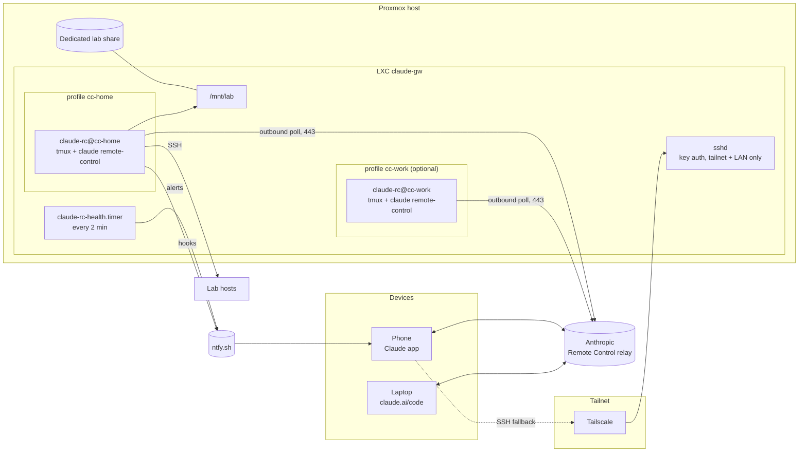
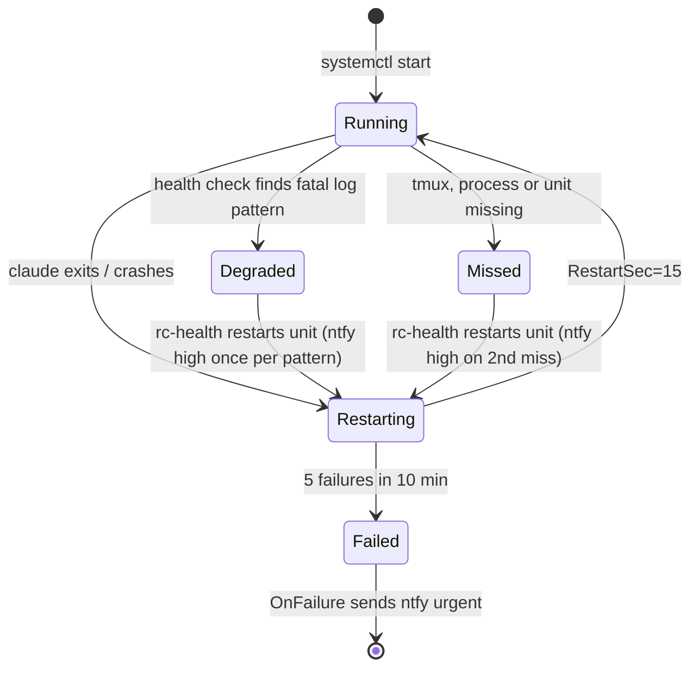
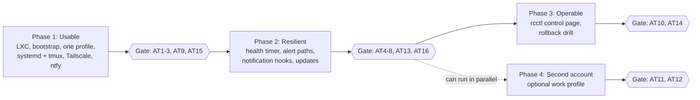

# claude-gw design

## Summary

A single always-on LXC container on a Proxmox host (`claude-gw`) runs Claude Code in Remote Control **server mode**, one server per account profile, supervised by systemd and tmux. New sessions can be started from the Claude mobile app, a laptop, or claude.ai/code anywhere in the world without first shelling in. Tailscale provides the fallback SSH path (and, in phase 3, the only route to a small Go control page). Failures that supervision cannot recover from are pushed to the phone via ntfy.

Why this shape: Remote Control is the only first-party mechanism that keeps execution and filesystem access on the lab side while exposing a full session to mobile and web. A machine running `claude remote-control` appears as a device in the Code tab of the Claude app, and a session can be started from there on demand.

Goals, in priority order:

1. Start or resume a Claude Code session against lab resources from any device, from anywhere, in under 30 seconds and with no SSH step.
2. Sessions survive the container rebooting, the `claude` process crashing, or a network blip, without manual intervention.
3. When they do not survive, the phone is told within two minutes.
4. Separate accounts (for example personal and work) never share credentials, transcripts or working trees.
5. Every change to the gateway itself is versioned and reversible.

## Requirements and constraints

| # | Requirement | How it is met |
| --- | --- | --- |
| R1 | Start a new session from mobile or a laptop without shelling in first | `claude remote-control` server mode |
| R2 | Sessions reach the lab filesystem and lab hosts | One dedicated share bind-mounted at `/mnt/lab`, SSH keys per profile, local MCP servers |
| R3 | Tailscale and SSH access to the gateway as a fallback | Also needed for commands Remote Control cannot run from mobile (`/plugin`, `/resume`, `claude mcp login`) |
| R4 | Crashed processes restart; the service survives reboots | systemd template unit per profile, tmux as the pty holder |
| R5 | Alert via ntfy when a restart fails or a server stays down | systemd `OnFailure=` plus a health timer |
| R6 | A control page for session management and inspection | Phase 3: small Go service, tailnet-only |
| R7 | Separate identities per account | `CLAUDE_CONFIG_DIR` per profile, separate Linux users, separate units |
| R8 | Full change control and rollback for the gateway itself | Git tags, `make deploy`, vzdump backups |

| # | Constraint | Consequence |
| --- | --- | --- |
| C1 | Remote Control requires a claude.ai subscription login; API keys and `setup-token` long-lived tokens are refused | First login for each profile is interactive; the service reuses that credential. `rc-start` unsets any API-key variables |
| C2 | The `claude` process must keep running; if it stops, sessions go offline | Supervision is the whole point of R4 |
| C3 | Server mode exits after roughly 10 minutes without network | `Restart=always` with back-off |
| C4 | Sessions can be resumed for about four hours after a server stops | Alert fast so a restart lands inside that window |
| C5 | Workspace trust and the one-time Remote Control consent must be answered at a terminal | Done once per profile by `bootstrap/profile-login.sh` |
| C6 | Team/Enterprise accounts need an Owner to enable Remote Control in admin settings | Check before building a work profile |
| C7 | Transcripts are stored on Anthropic servers while Remote Control is connected | Check your organisation's policy for any work profile; Zero Data Retention configurations block Remote Control |
| C8 | Remote Control is unavailable through an LLM gateway or Bedrock | Profiles talk to api.anthropic.com directly |

## Architecture

One LXC does all the work; devices never talk to it directly for sessions.



Sessions flow through Anthropic's relay: the gateway polls outbound, so nothing is exposed at the router. Everything else (SSH, the phase 3 control page, the one-off commands Remote Control cannot run from a phone) goes over the tailnet. The Remote Control servers are the same binary with different config directories, so profiles never share a credential or a transcript.

## Component design

### Gateway container

An unprivileged Debian 13 LXC on Proxmox, 2 vCPU, 4 GB RAM, 32 GB disk, created by `proxmox/create-lxc.sh` with `nesting=1,keyctl=1` (systemd needs nesting in an unprivileged container) and `/dev/net/tun` for Tailscale. An LXC rather than a VM because it backs up and restores in seconds and the workload is a Node process plus SSH.

One dedicated lab share from the host is bind-mounted read-write at `/mnt/lab`. It is the only part of the lab filesystem a session can touch. `bootstrap/bootstrap.sh` installs Node, Claude Code, tmux, jq, git and Tailscale, and creates the profile users (`cc-home`, `cc-work`) in a shared `cc-lab` group, each with its own home directory, SSH key pair to lab hosts, and `CLAUDE_CONFIG_DIR`.

### Remote Control servers

One `claude remote-control` server per profile, started in a tmux session owned by that user. Each server serves many concurrent sessions (`RC_CAPACITY`), and `--spawn worktree` gives each session its own git worktree of `WORKDIR`, so one server per profile covers many parallel tasks.

`bin/rc-start` (run as the profile user, with the unit having loaded the root-only `/etc/claude-rc/<profile>.env`) unsets any API-key or gateway variables, and execs:

```bash
claude remote-control \
  --name "$RC_NAME" \
  --spawn "$RC_SPAWN" \
  --capacity "$RC_CAPACITY" \
  --permission-mode "$RC_PERMISSION_MODE" \
  --verbose
```

Bootstrap steps that must be done once at a terminal, per profile (`bootstrap/profile-login.sh`): `claude auth login` (the claude.ai option, not an API key), the Remote Control consent prompt, and the workspace trust prompt. After that the server starts unattended. The script also seeds `WORKDIR` as a git repo (worktree spawn mode needs one) with a `CLAUDE.md` that tells every session to read and update a `HANDOVER.md` in its working tree (a per-session notes file, kept current by the `Stop` hook below).

### Supervision

systemd owns the lifecycle; tmux owns the pty that `claude remote-control` needs. One template unit, `claude-rc@.service`, instantiated per profile. Its key settings:

| Setting | Value | Why |
| --- | --- | --- |
| `Type=forking`, `ExecStart=tmux -L rc-%i new-session -d -s rc rc-start` | | tmux detaches; `rc-start` execs `claude`, so the tmux session and the unit end when `claude` exits |
| `ExecStartPost=tmux pipe-pane ... >> /var/log/claude-rc/%i.log` | | Pane output mirrored to a log for the health check |
| `Restart=always`, `RestartSec=15` | | Back within 15 s of any exit |
| `StartLimitBurst=5`, `StartLimitIntervalSec=600` | | Five failures in ten minutes stops retrying |
| `OnFailure=claude-rc-alert@%i.service` | | That stop is the signal that a human is needed |
| `ProtectHome=tmpfs`, `BindPaths=/home/%i`, `NoNewPrivileges=yes` | | A session cannot see another profile's home |



`claude-rc-health.timer` runs `bin/rc-health` every 2 minutes for every enabled instance. A profile is healthy when the unit is active, its tmux session exists, a `claude` process is running, and the last 60 log lines contain no known fatal pattern (expired credentials, Remote Control disabled, and similar). A miss restarts the unit; two consecutive misses alert. A fatal pattern alerts once per distinct pattern and restarts. A recovery after an alert sends a low-priority message. State lives in root-only `/var/lib/claude-rc` so alerts do not repeat.

### Alerting via ntfy

One ntfy topic per profile on ntfy.sh with an access token. Alert bodies carry only the profile, unit and severity, so no lab detail leaves the house.

| Priority | Source | Meaning |
| --- | --- | --- |
| urgent | `claude-rc-alert@` (systemd `OnFailure`) | Unit hit its restart limit; needs a human |
| high | `rc-health` | Two consecutive missed checks, or a fatal pattern in the log |
| high / default / low | Claude `Notification` hook | Permission prompt / question / idle |
| low | `rc-health` | Recovered |

The `Notification` hook duplicates Claude's own push notifications on purpose: ntfy still works if the Remote Control connection is the thing that broke. A `Stop` hook (`profiles/hooks/handover.sh`) writes the session's last state to `HANDOVER.md` in its working tree, so a fresh session can pick up where a stale one left off.

### Egress firewall

`proxmox/firewall.sh` puts a Proxmox firewall on the container's network interface. It runs on the host, so nothing inside the container, root included, can turn it off. Inbound, only SSH from `LAN_CIDR`, Tailscale's UDP port and ping from private ranges are accepted. Outbound, the container may reach its DNS resolver, the hosts in the `lab_allow` IP set (all ports), and the internet on TCP 22/80/443 and Tailscale's UDP ports; every other private or carrier-grade NAT address, and anything in `LAN_CIDR`, is dropped, the Proxmox host included (`enable` refuses if a host address falls outside those). All outbound IPv6 is dropped: the container has no IPv6 route, and link-local addresses would otherwise reach the LAN.

| Command (on the host) | Effect |
| --- | --- |
| `enable <ctid>` | First time: writes `/etc/pve/firewall/<ctid>.fw` from `LAN_CIDR` and `DNS`, turns on the datacenter firewall with ACCEPT policies and the host's own firewall off (so only this container is affected), and sets `firewall=1` on `net0`. After that it only flips the container's `enable` option |
| `disable <ctid>` | Prints what a session could then reach, asks for the CTID to be typed, logs to the host syslog. `status` shows DISABLED until it is re-enabled |
| `allow` / `remove <ctid> <ip\|cidr>`, `list` | Edits `lab_allow`. IPv4 only, /16 at widest, and the Proxmox host's own addresses need `FORCE=1` |

The firewall cannot see inside the Tailscale tunnel, so what the gateway can reach on the tailnet is set by the Tailscale policy: tag the node `tag:claude-gw`, allow the owner's devices to its port 22 (and 443 for `rcctl`), and give the tag no outbound access. Exfiltration over HTTPS to any internet address remains possible; closing that would need a domain allowlist through a proxy.

### Managed Claude settings

`make deploy` installs `profiles/settings.json` as `/etc/claude-code/managed-settings.json`. Managed settings are root-owned and take precedence over anything a profile or project sets, so a session cannot remove the hooks or deny rules, and `disableBypassPermissionsMode` blocks `bypassPermissions` outright. `acceptEdits` also approves common file commands such as `rm` inside the working directory without asking, so managed `ask` rules make deletes and history rewrites (`rm`, `git rm`, `git reset`, `git clean`, `git push --force`) prompt on the phone; that prompt is what AT13 exercises. Each profile's own `settings.json` (plugins, MCP config, its approvals) is left alone. Isolation between profiles is enforced by the OS (separate users, `ProtectHome`, 0700 config and working directories, root-only env files), not by these rules.

### Control page (phase 3)

A single Go binary (`rcctl/`) served only on the tailnet via `tsnet`, as its own tailnet node `claude-gw-ctl`, so no port is open on the LAN. Tailscale identity is the authentication: a request is served only if it comes from an untagged node whose login is in `RCCTL_ALLOW` (`/etc/default/rcctl`). Actions are POST only and need an `X-Rcctl` header, which a cross-site form or link cannot send, and each one is logged to the journal with the caller's login.

It runs as an unprivileged `rcctl` user. It reads the journal through the `systemd-journal` group, and `DEPLOYED_TAG` and `CLAUDE_VERSION` by name (`/etc/claude-rc` is traverse-only; the env files stay 0600). Restart, update and `rc-inspect` go through `sudo -n` with exact commands from `systemd/sudoers.d/claude-rc`; nothing else can be run that way. tsnet's log upload to Tailscale is turned off, and the first start prints a login URL to `journalctl -u rcctl` instead of storing an auth key. The tailnet needs HTTPS certificates turned on; note that the certificate puts the `claude-gw-ctl` hostname in public Certificate Transparency logs.

One scrolling page, in this order (design: `docs/superpowers/specs/2026-11-01-rcctl-page-redesign-design.md`):

| Section | Data source | Actions |
| --- | --- | --- |
| Health | `systemctl show claude-rc@<profile>` and the newest `rc-health` verdict per profile in its journal: one colour for the gateway (green all good, amber restarting or missed checks or a fatal pattern, red down), a headline, Claude Code version, deployed tag, last check | restart a profile, view its server log |
| Sessions | `rc-inspect <profile> sessions`: JSON lines for every session of the last 36 h, split in the browser into Now (a Claude process in its directory, or written in the last 5 min) and Earlier today in the viewer's timezone | open a session's details page: start and last activity, worktree, branch, uncommitted changes, the last 50 prompts, replies and tool calls |
| Alerts | the current problems from the Health signals, then `rc-alert`'s journal records (`-t rc-alert`) for 24 h, repeats folded into one row | silence for 1 h or 4 h, or turn back on |
| Worktrees | `rc-inspect <profile> worktrees`: branch, merged into `main`, clean, in use | prune the finished ones |
| Update | `journalctl -u claude-rc-update` | run `rc-update` (starts `claude-rc-update.service`) |

Times go to the browser in UTC and are shown in the viewer's timezone. The ↗ icon next to a session opens the Claude app's session list: the app's `session_` links share no ID with transcripts or worktrees, and the server log only places them near each other, so a per-session link would be a guess.

`bin/rc-inspect` reads a profile's transcripts and worktrees. `rcctl` runs it through `sudo` with an exact command per profile and action, and it re-runs itself as the profile user (profile directories are 0700, and root must not follow paths a profile controls), passing on only the two paths from the env file, not the ntfy token. Prune removes a worktree only when its branch is merged into `main`, it has no changed, untracked or ignored files (removal would delete ignored ones), none of the profile's processes has its working directory inside it, and its transcripts have not changed in 24 h. The last two matter because a new session's untouched branch already counts as merged. `git worktree remove` refuses dirty work as a second check. `rc-health` moves its state on only once an alert is sent, so a silenced or failed alert (including a recovery) is retried on the next check and an outage that outlasts the silence alerts when it ends. A degraded pattern seen during a silence is cleared by the restart that follows, so it alerts later only if it comes back, as a real login failure does.

Silencing writes an end time to `rcctl`'s own state directory, and `rc-alert` skips the high and low health alerts until then. The urgent "down" alert always sends, and Claude's own permission-prompt notifications are not affected. `rc-alert` records every attempt (sent, silenced or failed) in the journal for the page's history. On a miss `rc-health` runs `reset-failed` before restarting, so a server systemd gave up on (an outage longer than the client's retries hits the start limit) recovers within one check of the cause clearing; the urgent alert is sent once per outage, not on each retry, and the outage ends at the first healthy check even if its "recovered" push is held back by a silence. Clear history on the page hides older entries by storing a time in `rcctl`'s state directory; the journal keeps them. `OnFailure` also fires when a deliberate restart has to kill a hung server (the unit passes through "failed" on its way back up), so `rc-alert` sends the urgent alert only if the unit is still failed 5 s later, which is the case when systemd has given up. `make deploy` and `make rollback` end with one push per profile ("deployed <tag> (was <tag>)"), so a planned restart announces itself and is not mistaken for an outage: low as soon as `rc-health --ready` passes (every server healthy and up 10 s; a read-only check that never restarts anything), high if it has not after 60 s. `rc-health` logs its verdicts as `rc-health` whether the timer runs it or someone runs it by hand, and the page reads them by that identifier, from root only (`_UID=0`, set by journald): any local user, a Claude session included, can log under any identifier, so the identifier alone would let a session paint the page green or fake the alert history. Its tmux probe has a 10 s timeout: a hung server freezes its whole cgroup, tmux included, and a probe that would block counts as a miss instead. The urgent alert comes from systemd rather than `rc-health`, so when it is sent `rc-alert` marks `rc-health`'s state as alerted, and the next healthy check sends "recovered".

The page is deliberately thin: Remote Control already provides the live session UI, so `rcctl` only covers what the Claude app cannot show (process state, logs) and what it cannot do (restart the server, update Claude Code).

The binary is built reproducibly by `make rcctl` (pinned Go image, `-trimpath`, no build ID); its sha256 is committed as `rcctl/rcctl.sha256`, and `make deploy` installs `dist/rcctl` only if it matches. The page is opt-in: `make deploy` installs the binary and unit but never enables them.

## Multiple accounts

Run each account as its own Linux user with its own `CLAUDE_CONFIG_DIR` and its own Remote Control server. Claude Code keeps everything that makes an account yours (credentials, settings, session history, plugins, memory) under one directory, and `CLAUDE_CONFIG_DIR` picks which one is live, so two directories give two permanently signed-in accounts that know nothing of each other.

| Layer | Profile A (`cc-home`) | Profile B (`cc-work`, optional) | Why the split |
| --- | --- | --- | --- |
| claude.ai account | Personal subscription | Team/Enterprise seat | Remote Control is per subscription; sessions appear only in the account that started them |
| Linux user + config dir | `cc-home` / `~/.claude-cc-home` | `cc-work` / `~/.claude-cc-work` | Credentials, transcripts and hooks cannot leak across |
| Working trees + credentials | `/mnt/lab/home`, personal keys | `/mnt/lab/work`, work keys | A session never holds the other account's cloud or git credentials |

On the device side, switching is a matter of which account the Claude app or claude.ai is signed into. Server cards and session lists are per account. Before adding a work profile, confirm an Owner has enabled Remote Control for the organisation and that its data policy permits transcripts on Anthropic servers (C6, C7). A work profile may belong on a second gateway on work infrastructure instead; the same image, units and scripts deploy there with only the env file differing.

## Security model

The gateway has no inbound ports on the internet; the only ways in are Anthropic's relay (outbound-polled) and SSH from the tailnet or the local LAN.

| Surface | Control |
| --- | --- |
| Session access from devices | Trusted Devices turned on for each account: each phone, browser and desktop app enrols, and a sign-in older than 18 h needs Face ID / Touch ID / passkey before it can steer a session |
| SSH | Key auth only; `AllowUsers` limited to the tailnet ranges and `LAN_CIDR` (`bootstrap/bootstrap-tailscale.sh`) |
| Control page (phase 3) | `tsnet` only (no LAN port); untagged nodes with a login in `RCCTL_ALLOW`; actions need the `X-Rcctl` header and are logged with the caller. Whoever controls an allowed Tailscale login can restart servers, run `rc-update`, read session first prompts, prune finished worktrees and silence the non-urgent alerts for up to 4 h |
| What a session can do | `--permission-mode acceptEdits`, never `bypassPermissions`; destructive commands still prompt, and the prompt reaches the phone via push and ntfy |
| Blast radius of a bad prompt | Each profile is a separate unprivileged user; one dedicated share at `/mnt/lab` is the only lab filesystem mounted; cloud and hypervisor credentials scoped to lab-only roles |
| Secrets at rest | Credentials in each profile's config dir (0700); ntfy tokens in `/etc/claude-rc/*.env` (0600 root), never in git. A profile's own sessions can still see its ntfy topic and token in their environment, because the notification hook needs them; use a token that can only publish to that topic |
| Host | Unprivileged LXC; no other bind mounts |
| Network reach | Egress firewall on the host (`proxmox/firewall.sh`): DNS, the internet on 22/80/443 and lab hosts on an allowlist; the rest of the LAN and the Proxmox host are dropped. Can be disabled, with a warning |
| Audit | journald for the units, Claude's own transcripts per profile, and (phase 3) `rcctl` logs every action with the requesting Tailscale identity |

### If Anthropic, the account or Claude Code is compromised

The gateway's purpose is to let a remote service run commands inside a private network. Every control in the table above that lives in Claude Code or on Anthropic's side (Trusted Devices, permission prompts, the approvals that answer them, managed-settings deny rules, `disableBypassPermissionsMode`) is only as trustworthy as Anthropic's relay, account system, model serving and the `@anthropic-ai/claude-code` npm package. Treat the gateway as a remote shell whose owner is whoever controls those.

| Compromise | What it gives the attacker |
| --- | --- |
| Your claude.ai account (stolen session, phished login) | Start sessions on the gateway's card from their own device. Trusted Devices raises the bar but is enforced by Anthropic |
| Anthropic's relay or account system | Start sessions as you without a device, and forge the approvals that answer permission prompts. Prompts and ntfy alerts still fire, but cannot be relied on to stop anything |
| Model output (malicious or prompt-injected responses, including injected text in files under `/mnt/lab` or a worktree's `HANDOVER.md`) | Tool calls that try to do harm. Permission prompts still apply, so this depends on you approving them, unless combined with a relay compromise |
| The npm package (malicious release) | Code runs as root during `npm install -g` (bootstrap, `rc-update`), then as each profile user every time a server starts. No Claude Code control applies; deny rules and permission modes are enforced by the very code that is compromised |

What a compromised gateway can reach is everything the profile's Linux user can reach, because that is the only boundary not owned by Anthropic:

- `/mnt/lab` read-write: read, exfiltrate, encrypt or delete it, and plant files that prompt-inject later sessions.
- The network: the container sits on the LAN bridge and the tailnet with unrestricted egress unless the egress firewall is on, so it can scan and attack other LAN hosts, other tailnet nodes the Tailscale ACLs allow, and anything on the internet.
- Credentials in the profile's home: the claude.ai login, the profile's ntfy token, and any SSH keys or cloud credentials placed there, which turn into lateral movement to those hosts and accounts.
- Persistence as that user: user crontab, shell rc files, git hooks in the worktrees, modified files in `/mnt/lab`.

What it cannot reach without a further local or kernel exploit: root in the container (the profile has no sudo; the only sudoers entry is for the phase 3 `rcctl` user), the other profile's home and credentials, the root-only env files, the Proxmox host (unprivileged LXC, so container root maps to an unprivileged host uid), and host-side ZFS snapshots of the share. A malicious npm release is the exception: it runs as root in the container, so treat the whole container as lost and restore it from a vzdump backup.

Mitigations, roughly in order of value:

1. **Restrict egress**: `proxmox/firewall.sh enable` (see "Egress firewall" above), with `lab_allow` holding only the lab hosts sessions actually need. Tag the gateway in Tailscale and give the tag no access to other nodes. This is what turns "inside the private network" into "inside one share and a short list of hosts".
2. **Scope credentials**: only lab-only, least-privilege keys in profile homes; on target hosts, restrict them (`from=`, a non-root account, forced commands where possible). No cloud admin credentials.
3. **Keep the share recoverable**: ZFS snapshots of the share dataset on the host, which the container cannot delete.
4. **Updates**: the nightly `rc-update` timer is off by default. Enabling it, or installing `latest` on release day, shortens the window between a malicious npm release and it running here; `CLAUDE_CHANNEL=stable`, or pinning a version and updating by hand after a few days, lengthens it.
5. **Account hygiene**: Trusted Devices, a hardware key on the claude.ai account, and checking active sessions and devices on the account.
6. **Kill switch**: `systemctl stop claude-rc@<profile>` in the container, `pct stop <ctid>` on the host (works even if the container is compromised), and signing out the gateway's session on claude.ai.

## Change control and rollback

Every part of the gateway is either a git-tracked file or covered by a Proxmox backup, and each has a named rollback.

| What changes | Where it lives | How it is applied | Rollback |
| --- | --- | --- | --- |
| Container OS, Node, Claude Code version | The LXC itself | `apt` / `npm` after `proxmox/snapshot.sh take <ctid> <slug>` (vzdump; `pct snapshot` is unavailable with a bind mount) | `proxmox/snapshot.sh back <ctid> <volid>` (`pct restore`) |
| systemd units, scripts, hooks, managed settings | This repo, checked out at `/opt/claude-gw` | `make deploy TAG=vX.Y` from a clean tree on a tag | `make rollback` (redeploys the previous tag) |
| Claude Code itself | npm global, `latest` release (`CLAUDE_CHANNEL=stable` for the slower channel) | `rc-update` by hand, or nightly via the opt-in `claude-rc-update.timer`: install, restart the servers, run the health check | Automatic: an unhealthy result reinstalls the previous version and alerts. By hand: `rc-update <version>` |
| Env files with secrets | `/etc/claude-rc/<profile>.env` | Edited by hand; `make deploy` never writes them | Covered by the vzdump backup |
| Lab repos the sessions edit | Their own git remotes | `--spawn worktree` keeps each session on its own branch | `git worktree remove`; branch deleted |

Rules:

1. No change to the gateway without a backup first and a repo tag after; `make deploy` refuses a dirty tree or an untagged HEAD.
2. Claude Code updates go through `rc-update`, whose health check and automatic revert stand in for the backup and acceptance run. That catches a server that will not start or logs a known fatal error, not a quiet behaviour change, so leave the timer off if you want every update reviewed. Claude Code's own auto-updater is disabled (`DISABLE_AUTOUPDATER=1`); the profile users could not write the global install anyway.
3. A failed acceptance test after a change is a rollback, not a fix-forward, unless the fix is itself a one-line reversible change.

## Definition of done and acceptance tests

Done means every test for the phase passes on the deployed tag, from a device that is off the home network where the test says so, and the results are committed under `tests/results/<tag>.md`. Opt-in tests (AT17, the egress firewall) count only for a gateway where the feature is enabled. The full checklist, with methods and pass criteria, is [`tests/acceptance.md`](../tests/acceptance.md). In summary:

| ID | Test | Phase |
| --- | --- | --- |
| AT1 | New session from the phone, off-network, lists `/mnt/lab` within 30 s | 1 |
| AT2 | Same from each laptop | 1 |
| AT3 | A session reaches lab hosts | 1 |
| AT4 | `kill -9` of the server recovers within 60 s | 2 |
| AT5 | Container reboot recovers within 2 min | 2 |
| AT6 | 15-minute outbound outage recovers; ntfy high received | 2 |
| AT7 | Hard failure fires the urgent alert within 2 min | 2 |
| AT8 | `kill -STOP` (hung process) caught by the health timer | 2 |
| AT9 | Tailscale + SSH fallback attaches to the live server | 1 |
| AT10 | Control page lists servers, health, logs, sessions and worktrees; restart, update, prune and silence work and are logged with the caller; other logins and headerless POSTs get 403 | 3 |
| AT11 | Account isolation enforced by the OS, not just Claude | 4 |
| AT12 | Work account sees only its own server card | 4 |
| AT13 | Permission prompt reaches the phone via push and ntfy | 2 |
| AT14 | A broken release rolls back within 2 min | 3 |
| AT15 | Trusted Devices enforced on an un-enrolled browser | 1 |
| AT16 | Claude Code update installs, and a bad one reverts with an alert | 2 |
| AT17 | Egress firewall drops the LAN and the Proxmox host, allows the internet and listed hosts; disabling it warns and is logged | 2, opt-in |

Non-functional: idle CPU under 5 %, memory under 1.5 GB with servers idle, nothing listening on the LAN except Tailscale and filtered sshd, and bootstrap from a fresh LXC to AT1 under 20 minutes excluding the interactive logins.

## Implementation phases

Phase 1 is usable on its own and is where the value lands; the rest hardens it. Nothing moves to the next phase until its gate tests pass and the tag is recorded.



Each phase ends with a backup and a repo tag (`v0.1`, `v0.2`, ...).

| Phase | Status (2026-11-02) |
| --- | --- |
| 1 | AT1-3 and AT9 pass; AT15 (Trusted Devices) deferred |
| 2 | Complete: AT4-8, AT13 and AT16 pass (`v0.6.8`); AT17 opt-in (firewall not enabled) |
| 3 | Complete: AT10 and AT14 pass (`v0.6.4`) |
| 4 | Not started |

## Risks

| Risk | Likelihood | Mitigation |
| --- | --- | --- |
| Remote Control sessions go stale overnight (spinner on mobile); see anthropics/claude-code issues #28914 and #41128 | Medium | Health timer restarts the server; sessions resume within the 4 h window; otherwise start a new session from the device card. The `Stop` hook's per-worktree `HANDOVER.md` means only conversation context is lost |
| Anthropic changes server-mode flags or error wording in a Claude Code release | Medium | `rc-update` reverts if the health check fails; rerun AT1-AT8 after updates you care about |
| The claude.ai login on the gateway expires or is revoked | Low | `rc-health` detects the fatal log pattern and alerts naming the profile; rerun `profile-login.sh` |
| A compromised phone steers a lab session | Low | Trusted Devices, `acceptEdits` not `bypassPermissions`, lab-scoped credentials |
| Anthropic's relay, the claude.ai account or the Claude Code npm package is compromised, giving an attacker command execution inside the private network | Low, high impact | See "If Anthropic, the account or Claude Code is compromised": egress firewall, scoped credentials, host-side snapshots, auto-update off, kill switch |
| Proxmox host down | Low | Out of scope; this is the lab's existing availability |

## Alternatives considered

- [Claude Deck](https://github.com/moonexpr/claude-deck): open-source session dashboard over a tailnet, but a Tauri/Rust app with broader scope; a small Go service is easier to keep aligned with the systemd units.
- [Happy Coder](https://github.com/dvlkv/happy) and [Omnara](https://github.com/omnara-ai/omnara): not chosen because both add a third-party relay.

## Sources

- [Remote Control, Claude Code docs](https://code.claude.com/docs/en/remote-control): server mode flags, resume window, outage behaviour, Trusted Devices, auth requirements, connection model
- [Running multiple Claude Code accounts with CLAUDE_CONFIG_DIR](https://agentsroom.dev/blog/how-to-use-multiple-claude-code-accounts)
- [claude-multiprofile](https://github.com/jmdarre-v/claude-multiprofile): profile isolation for Desktop and Code
- [Mobile cannot resume idle sessions (#41128)](https://github.com/anthropics/claude-code/issues/41128) and [overnight disconnects (#28914)](https://github.com/anthropics/claude-code/issues/28914)
